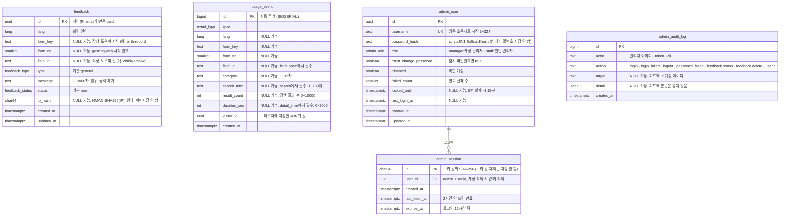

# ERD

기준: `prisma/schema.prisma` (마이그레이션 `20261101082752_init`). 스키마를 바꾸면 이 문서도 같이 바꾼다.

이용자 쪽 테이블 2개(`feedback`, `usage_event`)는 서로 관계(외래 키)가 없다.
관리자 쪽 3개(`admin_user`, `admin_session`, `admin_audit_log`, 2026-11-04 추가)는 이용자 쪽과 이어지지 않는다. `admin_session`만 `admin_user`를 가리키고(계정을 지우면 세션도 지움), 관리 기록은 계정이 지워져도 남도록 아이디를 글자로 적는다.
피드백과 이용 기록은 사람을 이어 붙이지 않으려고 일부러 따로 둔다 (피드백의 `ip_hash`와 이용 기록의 `visitor_id`는 같은 사람이어도 연결할 수 없다).
글자 수·범위 제한은 DB가 아니라 API 검사(zod)에서 건다. 아래 그림의 "1~2000자" 같은 표시는 API 기준이다.
서식(`form_key`·`form_no`)은 아직 DB에 서식 테이블이 없어 문자열·번호로만 적는다. 서식 데이터를 서버로 옮기는 단계에서 `form` 테이블과 관계를 만든다.

## enum

| 이름 | 값 |
| --- | --- |
| `lang` | `ko` `en` `zh` `ja` `vi` |
| `feedback_type` | `general` 일반, `translation` 번역, `guide` 안내 내용, `bug` 오류 |
| `feedback_status` | `new` 새 글, `read` 읽음, `resolved` 처리함 |
| `admin_role` | `manager` 계정 관리자, `staff` 일반 관리자 |
| `event_type` | gusring-web: `landing_view` `list_view` `form_view` `form_download` `language_select` `search` `category_filter` `feedback_click` `detail_time` 작성 도우미: `fill_start` `field_open` `fill_preview` `fill_png_save` `fill_print` `fill_reset` |

같은 값이 `src/constants/enums.ts`에도 있다. 하나를 바꾸면 둘 다 바꾼다.

## 인덱스

| 테이블 | 인덱스 | 쓰는 곳 |
| --- | --- | --- |
| feedback | `(status, created_at DESC)` | 관리자 피드백 목록 (상태로 거르고 최신순) |
| feedback | `(form_key)` | 서식으로 거르기 |
| feedback | `(ip_hash, created_at)` | 같은 사람 10분 5건 제한 |
| usage_event | `(type, created_at)` | 통계 대부분 (종류 + 기간) |
| usage_event | `(form_key, type)` | 서식별 통계 |
| usage_event | `(created_at)` | 기간 전체 합계, 날짜별 |

## 받지 않는 값

서식에 적는 값(이름·주민등록번호·주소 등)은 어느 테이블에도 칸이 없다.
API도 정의되지 않은 칸이 섞인 이벤트는 묶음 전체를 거부한다 (`tests/events.test.ts`).

## 그림 도구

ERD Cloud 등에 올릴 때는 `prisma/migrations/*/migration.sql`을 가져오기(import)하면 같은 그림이 나온다.
